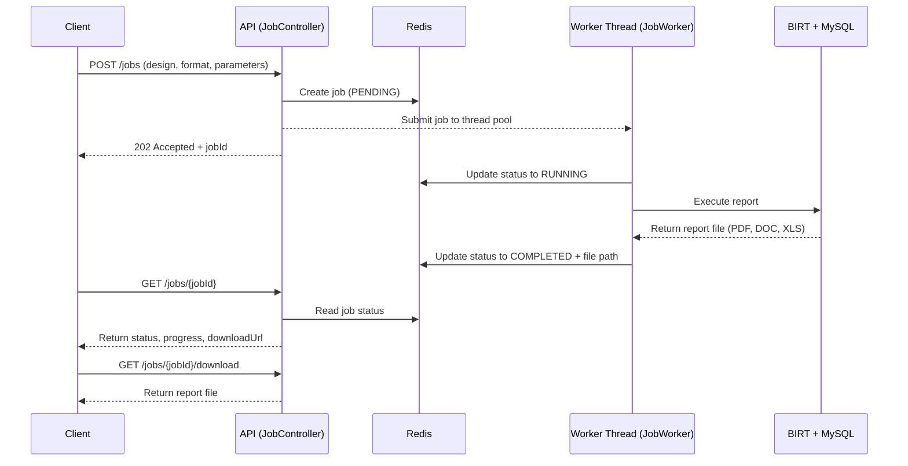
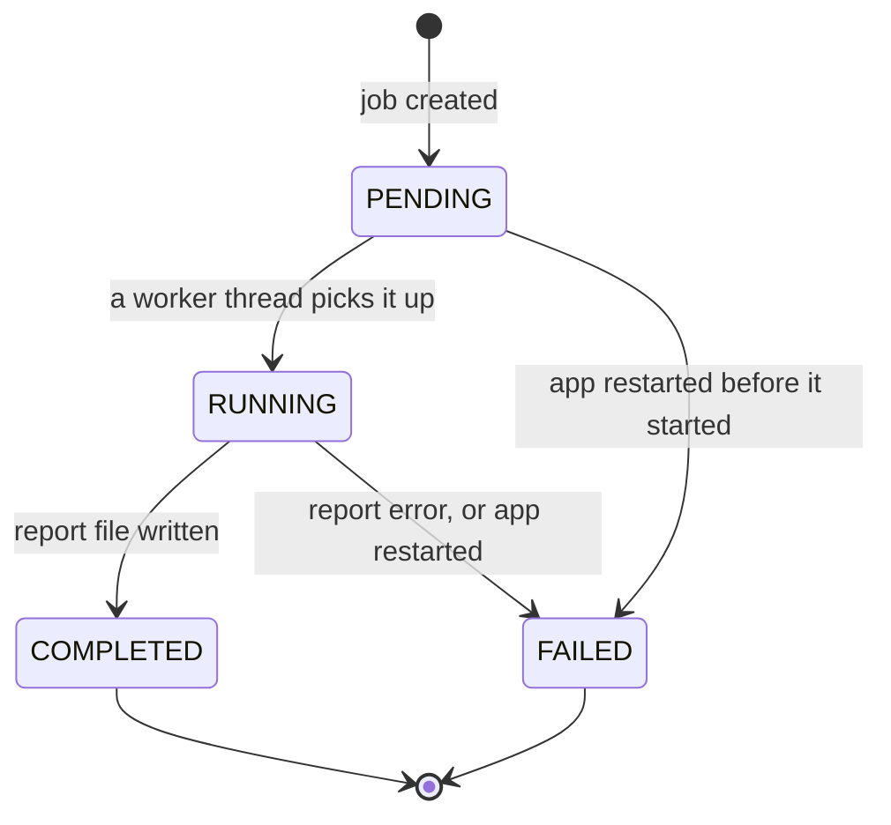

<div align="center">

# 📄 Report Job Service

**Submit a report job, poll its progress, download the result.**

An asynchronous reporting API built with Spring Boot, Redis and BIRT.


</div>

---

## Overview

Generating a report can take seconds or minutes, far too long to keep an HTTP request open. This service solves it with the **job-ID and polling pattern**:

1. The client asks for a report and gets a `jobId` back **immediately** (`202 Accepted`).
2. A background worker runs the BIRT report against MySQL and records its progress in Redis.
3. The client polls the job until it is `COMPLETED`, then downloads the file.

The client picks the **report design**, the **output format** (PDF, Word or Excel) and the **report parameters** per request, so one service can run any BIRT report.

## Contents

- [How it works](#how-it-works)
- [Features](#features)
- [Tech stack](#tech-stack)
- [Quick start](#quick-start)
- [Configuration](#configuration)
- [API reference](#api-reference)
- [Adding your own report](#adding-your-own-report)
- [Error handling](#error-handling)
- [Project structure](#project-structure)
- [Design decisions](#design-decisions)
- [Known limitations](#known-limitations)
- [Roadmap](#roadmap)

## How it works



### Job lifecycle



Each job is a Redis hash under the key `job:<jobId>` with the fields `status`, `progress`, and later `result` (the file path, never shown to clients) or `error`. A job expires **one hour after its last update**.

## Features

- **Non-blocking API.** `POST /jobs` answers in milliseconds. The work runs on a dedicated thread pool (`jobExecutor`).
- **Any BIRT report, chosen per request.** Pass the design name and a free-form `parameters` map. Values are converted to the type each report declares (integer, decimal, date, text, and so on).
- **Three output formats:** `pdf`, `doc`, `xls`.
- **Safe by default.** Design names accept only letters, digits, `-` and `_`, so path tricks are impossible. SQL parameters are bound by the JDBC driver, never pasted into the query. Clients never supply or see file paths.
- **Back-pressure.** When the pool and its queue are full, the API answers `503 Service Unavailable` with a `Retry-After` header and removes the rejected job, so nothing is left behind.
- **Restart recovery.** On startup, jobs left `PENDING` or `RUNNING` by a previous run are marked `FAILED`, so no client polls forever.
- **No key leaks.** The Redis TTL is refreshed on every write, so a slow job can never leave a key without an expiry.
- **Lazy BIRT engine.** The engine starts on the first report request and is shared by all jobs.

## Tech stack

| Area | Technology |
|---|---|
| Language | Java 17 |
| Framework | Spring Boot 4 (Web MVC, `@Async`) |
| Job state | Redis through Spring Data Redis (Lettuce, `StringRedisTemplate`) |
| Report data | MySQL, JDBC (MySQL Connector/J) |
| Reporting engine | BIRT runtime 4.8 |
| Build | Maven |
| Local services | Docker (Redis and MySQL) |

## Quick start

### Prerequisites

- Java 17
- Maven (or use the wrapper if your project has one)
- Docker, to run Redis and MySQL locally

### 1. Start Redis and MySQL

```bash
docker run -d --name my-redis -p 6379:6379 redis:7
docker run -d --name my-mysql -e MYSQL_ROOT_PASSWORD=root -p 3306:3306 mysql:8
```

> [!WARNING]
> These credentials are for local development only. Never reuse them anywhere real.

### 2. Create the sample data

Run this in a MySQL client. It creates the `products` table that the sample report reads.

<details>
<summary><b>Show the SQL (30 sample products)</b></summary>

```sql
CREATE DATABASE IF NOT EXISTS jobdemo;
USE jobdemo;

CREATE TABLE products (
    id INT PRIMARY KEY AUTO_INCREMENT,
    name VARCHAR(50),
    category VARCHAR(50),
    price DECIMAL(10,2)
);

INSERT INTO products (name, category, price) VALUES
    ('Laptop', 'Electronics', 899.99),
    ('Headphones', 'Electronics', 59.50),
    ('Desk Chair', 'Furniture', 149.00),
    ('Notebook', 'Stationery', 3.25),
    ('Coffee Mug', 'Kitchen', 8.75),
    ('Laptop Pro 15', 'Electronics', 1299.00),
    ('Laptop Stand', 'Electronics', 34.99),
    ('Wireless Mouse', 'Electronics', 24.50),
    ('Wireless Keyboard', 'Electronics', 49.00),
    ('USB-C Hub', 'Electronics', 39.90),
    ('Bluetooth Speaker', 'Electronics', 79.00),
    ('Monitor 27 inch', 'Electronics', 289.00),
    ('Office Desk', 'Furniture', 349.00),
    ('Standing Desk', 'Furniture', 599.00),
    ('Bookshelf', 'Furniture', 129.50),
    ('Desk Lamp', 'Furniture', 29.99),
    ('Sofa Bed', 'Furniture', 799.00),
    ('Pen Pack', 'Stationery', 5.50),
    ('Desk Organizer', 'Stationery', 14.25),
    ('Stapler', 'Stationery', 7.80),
    ('Sticky Notes', 'Stationery', 3.10),
    ('Whiteboard', 'Stationery', 45.00),
    ('Coffee Maker', 'Kitchen', 89.00),
    ('Electric Kettle', 'Kitchen', 32.50),
    ('Blender', 'Kitchen', 64.00),
    ('Knife Set', 'Kitchen', 55.75),
    ('Yoga Mat', 'Sports', 22.00),
    ('Dumbbell Set', 'Sports', 120.00),
    ('Running Shoes', 'Sports', 95.00),
    ('Water Bottle', 'Sports', 11.99);
```

</details>

### 3. Set up the report design

Put your `.rptdesign` file in the `report-designs/` folder (for example `products_report_filtered.rptdesign`). The database connection lives **inside the design file**: look for `odaURL`, `odaUser` and `odaPassword`.

> [!WARNING]
> `odaPassword` is stored as base64, which is an encoding, not encryption. Do not commit real passwords. Keep real credentials out of the repository.

### 4. Run the application

```bash
mvn spring-boot:run
```

Or run `JobServiceApplication` from your IDE. The API is then available at `http://localhost:8080`.

### 5. Try it

```bash
# 1. Start a job: Kitchen products that cost at least 10, as a PDF
curl -X POST http://localhost:8080/jobs \
  -H "Content-Type: application/json" \
  -d '{"design":"products_report_filtered","format":"pdf","parameters":{"category":"Kitchen","minPrice":10}}'
# -> {"jobId":"3f2a9c1e-8b4d-4e6a-9d21-5c7e0a1b2f34"}

# 2. Check the job
curl http://localhost:8080/jobs/3f2a9c1e-8b4d-4e6a-9d21-5c7e0a1b2f34

# 3. When it is COMPLETED, download the file
curl -OJ http://localhost:8080/jobs/3f2a9c1e-8b4d-4e6a-9d21-5c7e0a1b2f34/download
```

## Configuration

### `application.properties`

| Property | Default | Description |
|---|---|---|
| `spring.data.redis.host` | `localhost` | Redis host |
| `spring.data.redis.port` | `6379` | Redis port |
| `report.designs-dir` | `report-designs` | Folder that holds the `.rptdesign` files |
| `job.simulated-delay-seconds` | `70` | Fake wait added before each report, to watch progress and queueing. **Set to `0` for normal use.** |

### Built-in settings

| Setting | Value | Where |
|---|---|---|
| Worker threads | 2 core, up to 4 | `AsyncConfig` |
| Queue size | 50 | `AsyncConfig` |
| Job lifetime in Redis | 1 hour after the last update | `JobStore` |
| Output folder | `report-output/` | `ReportService` |

With these numbers, up to 54 jobs can be in flight (2 running on core threads, 50 waiting, plus 2 extra threads that start only once the queue is full). The 55th request is rejected with `503`.

> [!TIP]
> Add `report-output/` and `target/` to your `.gitignore`. Generated reports should not be committed.

## API reference

### `POST /jobs`

Starts a report job.

**Request body**

| Field | Required | Description |
|---|---|---|
| `design` | yes | Design file name **without** `.rptdesign`. Only letters, digits, `-` and `_` (up to 60 characters). |
| `format` | no | `pdf` (default), `doc` or `xls` |
| `parameters` | no | Map of report parameter name to value. Names must match the report's parameters exactly. Omitted parameters use the report's own defaults. |

```json
{
  "design": "products_report_filtered",
  "format": "pdf",
  "parameters": { "category": "Kitchen", "minPrice": 10 }
}
```

**Responses**

| Status | Meaning |
|---|---|
| `202 Accepted` | Job created. Body: `{"jobId": "..."}` |
| `400 Bad Request` | Missing body, invalid or unknown design, or unknown format. Body: `{"error": "..."}` |
| `503 Service Unavailable` | The server is busy. Includes a `Retry-After` header. Try again later. |

Parameter names and values are checked by BIRT while the job runs. A mistake there makes the **job** end as `FAILED` with an explanation, not the request.

### `GET /jobs/{jobId}`

Returns the current state of a job.

```json
{ "jobId": "3f2a...", "status": "RUNNING", "progress": 45 }
```

```json
{ "jobId": "3f2a...", "status": "COMPLETED", "progress": 100, "downloadUrl": "/jobs/3f2a.../download" }
```

```json
{ "jobId": "3f2a...", "status": "FAILED", "progress": 0, "error": "Parameter 'minPrice' has a wrong value: 'abc'" }
```

| Field | Present when | Notes |
|---|---|---|
| `jobId` | always | |
| `status` | always | `PENDING`, `RUNNING`, `COMPLETED` or `FAILED` |
| `progress` | always | 0 to 100. BIRT runs a report in one step and does not report percentages, so without the simulated delay it jumps from 0 to 100. |
| `downloadUrl` | `COMPLETED` | Relative URL of the file |
| `error` | `FAILED` | Short reason for the client |

Returns `404` if the job does not exist or has expired. Poll every few seconds and stop on `COMPLETED` or `FAILED`.

### `GET /jobs/{jobId}/download`

Downloads the generated file, with the matching content type and a `Content-Disposition` header.

| Format | Content type |
|---|---|
| `pdf` | `application/pdf` |
| `doc` | `application/msword` |
| `xls` | `application/vnd.ms-excel` |

| Status | Meaning |
|---|---|
| `200 OK` | The file |
| `404 Not Found` | No such job (or it expired) |
| `409 Conflict` | The job is not `COMPLETED` yet |
| `410 Gone` | The job completed, but the file is no longer on disk |

> [!NOTE]
> The `doc` and `xls` files are written by BIRT's classic emitters and open in Word and Excel. Tools that preview responses as text, such as some API clients, show them as XML.

## Adding your own report

1. Build the design in the [Eclipse BIRT report designer](https://eclipse-birt.github.io/birt-website/) and save it as a `.rptdesign` file.
2. Declare **report parameters** and give each one a default that means "do not filter by this" (for example `%` for a text filter used with `LIKE`). That makes every parameter optional.
3. In the data set, link each query placeholder `?` to a report parameter. The data set parameter's `paramName` must be the **name of the report parameter**.
4. Copy the file into `report-designs/`.
5. Call the API with the file name as `design` and the parameter names as keys in `parameters`.

Supported parameter types: integer, float, decimal, boolean, date (`2026-10-16`), time (`14:30:00`), date-time (`2026-10-16 14:30:00`) and text. Text filters are passed to the query as they are, so a "contains" search needs the SQL wildcard in the value, for example `"name": "%desk%"`.

## Error handling

| Situation | Result |
|---|---|
| Bad design name, design not found, unknown format | `400` with a message. No job is created. |
| Thread pool and queue are full | `503` with `Retry-After`. The job is removed from Redis. |
| Unknown parameter name, wrong value type | Job ends `FAILED` with the reason in `error`. |
| MySQL is down or the query fails | Job ends `FAILED`. BIRT can finish without throwing an exception, so the service checks the engine's error list explicitly. |
| App restarts while jobs are queued or running | On the next startup those jobs are marked `FAILED` ("Server restarted before the job finished"). |
| Job older than one hour | Expired from Redis, so `404`. |

## Project structure

```text
report-job-service/
├── pom.xml
├── report-designs/                  # BIRT designs, chosen by name in each request
│   └── products_report_filtered.rptdesign
├── report-output/                   # generated files (created at runtime, git-ignored)
└── src/main/
    ├── java/com/acme/
    │   ├── JobServiceApplication.java
    │   ├── AsyncConfig.java         # the "jobExecutor" thread pool
    │   ├── JobController.java       # REST endpoints
    │   ├── JobRequest.java          # body of POST /jobs
    │   ├── JobResponse.java         # response of GET /jobs/{id}
    │   ├── JobStatus.java           # PENDING | RUNNING | COMPLETED | FAILED
    │   ├── JobStore.java            # all Redis access for jobs
    │   ├── JobWorker.java           # the @Async worker
    │   ├── ReportService.java       # BIRT engine, runs a design with parameters
    │   ├── ReportDesigns.java       # safe lookup: design name to file
    │   ├── ReportFormat.java        # pdf | doc | xls and their content types
    │   └── StaleJobRecovery.java    # startup sweep for leftover jobs
    └── resources/
        └── application.properties
```

## Design decisions

- **`202 Accepted` plus polling.** The request only creates the job. The slow work never holds an HTTP thread.
- **Job created before the handoff.** The worker needs the job to exist when it starts. Creating it afterwards could let a fast worker's progress be overwritten.
- **One write for the final state.** `complete()` and `fail()` write status, progress and result (or error) in a single Redis command, so a client never sees `COMPLETED` without its result.
- **TTL refreshed on every write.** Without it, a job that outlives its TTL would be recreated by the next progress update without any expiry, and would stay in Redis forever.
- **Rejected jobs are deleted, restart leftovers are failed.** A rejected client never receives a `jobId`, so there is nobody to tell. A client whose job was lost in a restart does hold the `jobId` and is polling it, so it gets a `FAILED` answer.
- **Startup sweep in `@PostConstruct`.** It runs before the web server accepts requests, so every unfinished job it finds is by definition a leftover.
- **Engine started on demand.** A `synchronized` getter makes sure two jobs arriving together start BIRT only once.
- **The client never touches paths.** The file location is read from Redis, which only the worker writes. Design names are checked against a strict pattern and resolved inside one folder.

## Known limitations

- **One application instance only.** The startup sweep assumes no other copy shares the same Redis. Running several instances would need job ownership or a heartbeat.
- **Database credentials live inside each `.rptdesign` file.**
- **No authentication or rate limiting** on the API.
- **Generated files are never deleted** from `report-output/`.
- **BIRT 4.8 is old** (2018). Progress inside a single report run is not available.

## Roadmap

- [ ] Scheduled cleanup of old files in `report-output/`
- [ ] Move database credentials out of the report designs and into configuration
- [ ] Automated tests with JUnit and MockMvc
- [ ] Try `docx` and `xlsx` output
- [ ] Authentication
- [ ] Docker Compose file to start the app, Redis and MySQL together
